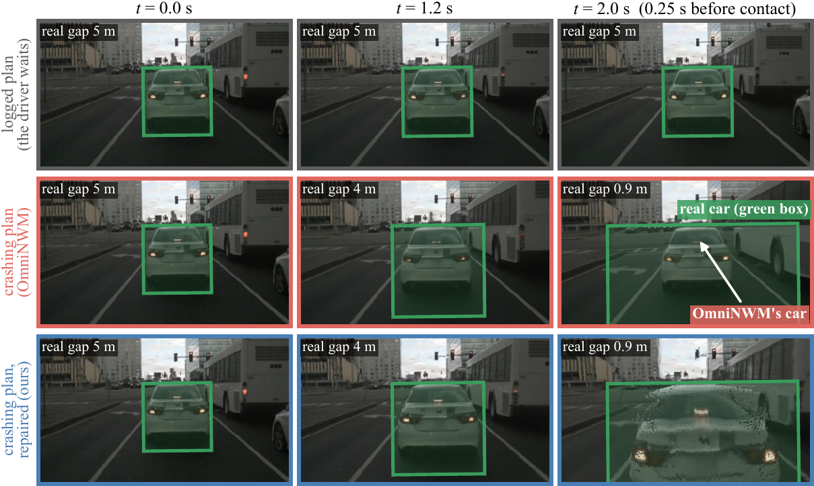

<div align="center">

# Plans Are Not Interventions
### Measuring and Repairing Plan Leakage in Driving World Models

**Sahil Apage** · **Medhansh Abhilash**
<br>Veermata Jijabai Technological Institute

**CoRL 2026 Workshop on Grounded 4D Multimodal World Models for Autonomous Driving Decision Making**
<br>*Accepted as Spotlight + Poster*

[**Project page**](https://sahilapage.github.io/plan-leak/) ·
[**Paper (PDF)**](https://sahilapage.github.io/plan-leak/assets/Plans_Are_Not_Interventions_CoRL2026_camera_ready.pdf) ·
[**Videos**](https://sahilapage.github.io/plan-leak/#omninwm)



</div>

## TL;DR

Ask a driving world model *"what if I drive into the car ahead?"* and it moves the car ahead away, so the crash never
appears. A model trained on driving logs learns what happened **when drivers chose** a plan, not what happens **if the
ego executes** it: slowing down in the logs usually means the car ahead slowed down, so the model learns to infer other
cars' motion from the plan. We call this the **plan leak**.

- **Measure.** Change only the plan and check whether cars that cannot react move. In OmniNWM the car ahead moves by
  as much as the ego advances (leak β = 1.00), even when it is stopped at a red light, while parked cars barely move.
- **Why it matters.** Policies trained in a leaky model crash up to 2.8× as often, and large leaks make planners brake
  unnecessarily.
- **Cause and repair.** The cause is how the model sees the plan, not missing data: training on counterfactual plans
  barely helps, letting each step see only the ego's past removes the leak, and averaging over past-only plans repairs
  frozen models, bringing OmniNWM's crash back in 16 of 18 scenes.

## Quick start (one minute, no GPU, no dataset)

```bash
git clone https://github.com/sahilapage/plan-leak-code.git
cd plan-leak-code
pip install -r requirements.txt
bash reproduce.sh
```

This runs the leak test (a self-check on two synthetic models, then OmniNWM's readouts: β = 1.00) and regenerates
Figs. 4, 5 and 9 to 12 of the paper from the included result files into `figures/`.

## Test your own world model for the leak

[`leak_test/leak_test.py`](leak_test/leak_test.py) needs only numpy and black-box access to the model. For each scene,
generate the future under the logged plan and under a counterfactual plan that changes only the ego's motion, read the
along-lane position of the ego and of each vehicle at the real contact time, and write one CSV:

| column | meaning |
|---|---|
| `scene`, `vehicle` | identifiers |
| `relation` | the vehicle's relation to the ego, e.g. `lead`, `parked` |
| `plan` | `logged` or `counterfactual` |
| `ego_s`, `vehicle_s` | along-lane positions (m) at the contact time |

```bash
python leak_test/leak_test.py demo                 # self-check: leaky model β ≈ 1, causal model β ≈ 0
python leak_test/leak_test.py score my_readouts.csv
```

It reports β per relation (median over scenes, with a scene-bootstrap 95% interval). The truth for the car ahead and
for parked cars is 0. At β = 1 the gap to the car ahead never closes, so every plan looks safe to a checker built on
the model. The counterfactual-plan rule is `counterfactual_plan()` in the same file and App. E of the paper.

## Repository layout

| Folder | What | Paper |
|---|---|---|
| [`leak_test/`](leak_test) | model-agnostic leak test and OmniNWM's readouts | Sec. 2, App. E |
| [`video_models/omninwm/`](video_models/omninwm) | windows, generation driver, registered scorer, odometry, controls, dose, repair | Sec. 3, 6, App. A, C |
| [`video_models/vista/`](video_models/vista) | Vista driver, scorer, execution checks | App. A |
| [`occupancy_models/`](occupancy_models) | leak by relation, log coupling, counterfactual fine-tuning | Sec. 3, 4, App. B |
| [`object_models/`](object_models) | object world models (plan input variants), g-computation, policy training | Sec. 4, 5, 6 |
| [`decision_benchmark/`](decision_benchmark) | 653 held-out decisions | Sec. 5, App. B |
| [`simulator_and_closed_loop/`](simulator_and_closed_loop) | simulator with true do() effects, closed-loop planners | Sec. 5, App. C |
| [`audit/`](audit) | re-derivation of the headline numbers with alternative readouts | App. D |
| [`figures/`](figures) | scripts for every figure, plus OmniNWM readouts | all |
| [`results/`](results) | every result table behind the numbers | all |
| [`prereg/`](prereg) | preregistration log, deviations, registration commits | App. F |
| [`videos/`](videos) | the 18 OmniNWM test scenes (below) | Sec. 3, 6 |
| [`lib/`](lib) | helpers shared by the scripts above | |

### Videos

- [`videos/three_plans/`](videos/three_plans): OmniNWM's front camera under the logged plan, the crashing plan and a
  past-only plan, with a bird's-eye strip of the real car (green).
- [`videos/repair/`](videos/repair): left, OmniNWM given the crashing plan (the car ahead stays away); right, the
  repair: OmniNWM's world for a past-only plan, seen from the crashing plan's cameras (the car fills the real car's
  position).

The same videos play in the browser on the [project page](https://sahilapage.github.io/plan-leak/#omninwm).

## Running the models

This is the research code as it was run, not a packaged library. Everything above the quick start works from the
included files. Re-running the world models themselves needs:

- **Data:** nuScenes v1.0 trainval and Occ3D.
- **Models:** the released OmniNWM, Vista, SparseWorld-TC, DOME and I²-World weights, from their official repositories.
- **Compute:** OmniNWM needs one 80 GB GPU (about 12 min per 33-frame clip).

Paths in the scripts are written as `<data>`, `<repo>`, `<work>` or `<home>`; replace them with your own. OmniNWM's
raw generations (several GB) are not included, but the readouts behind every OmniNWM number are
(`figures/omni_tracks_*.json`, `results/a37_final/`).

## Preregistration

Each confirmatory test was committed before the outputs it tests existed (`prereg/registration_commits.txt`: commit
hash and UTC time). `prereg/deviations.md` lists every deviation from the registered plans. The files here are the
copies anonymized for review; anonymization changed their bytes, so hashes recorded for earlier amendments do not
match these copies.

## Citation

```bibtex
@misc{apage2026plans,
  title  = {Plans Are Not Interventions: Measuring and Repairing
            Plan Leakage in Driving World Models},
  author = {Apage, Sahil and Abhilash, Medhansh},
  year   = {2026},
  note   = {CoRL 2026 Workshop on Grounded 4D Multimodal World
            Models for Autonomous Driving Decision Making}
}
```

## Notes

- Experiments, analysis code and the audit were carried out with an LLM coding agent (Claude Code) under author
  direction; the authors checked and take responsibility for all results and text.
- We thank the authors of OmniNWM, Vista, SparseWorld-TC, DOME and I²-World for releasing their models, and the
  nuScenes and Occ3D teams for the data.

## License

Code: MIT (see [`LICENSE`](LICENSE)). Files derived from nuScenes (readouts, result tables, videos) are shared under
the [nuScenes terms of use](https://www.nuscenes.org/terms-of-use) (non-commercial).
